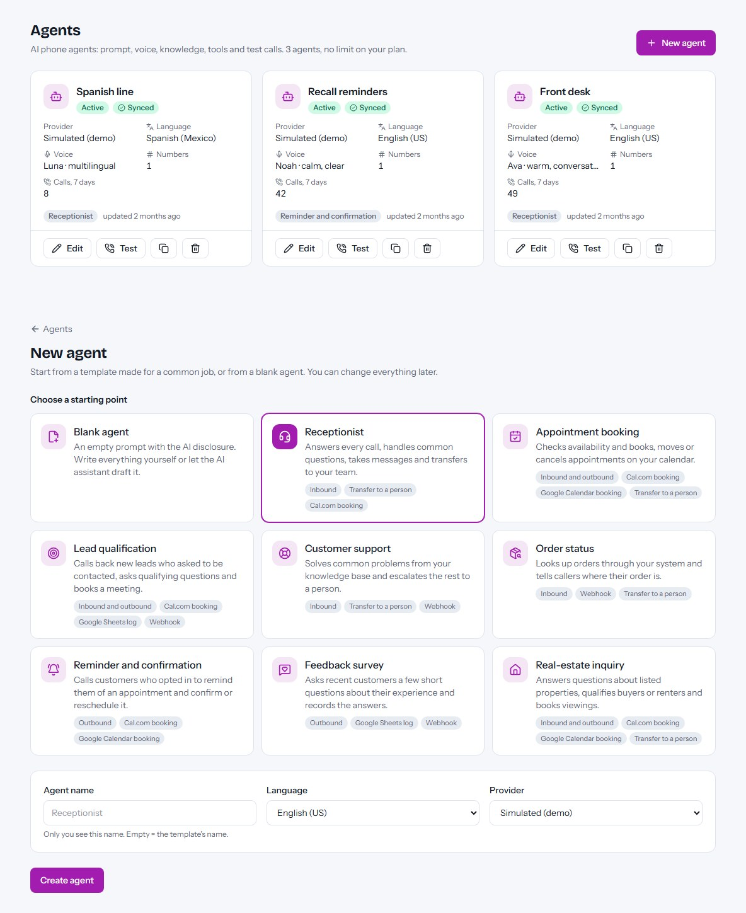
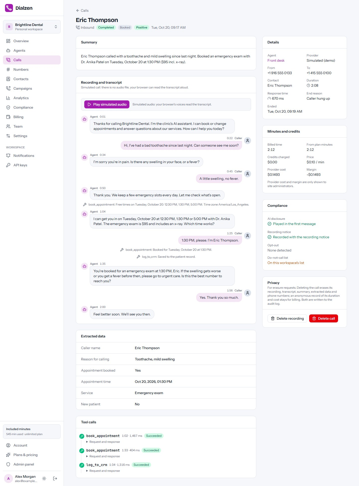
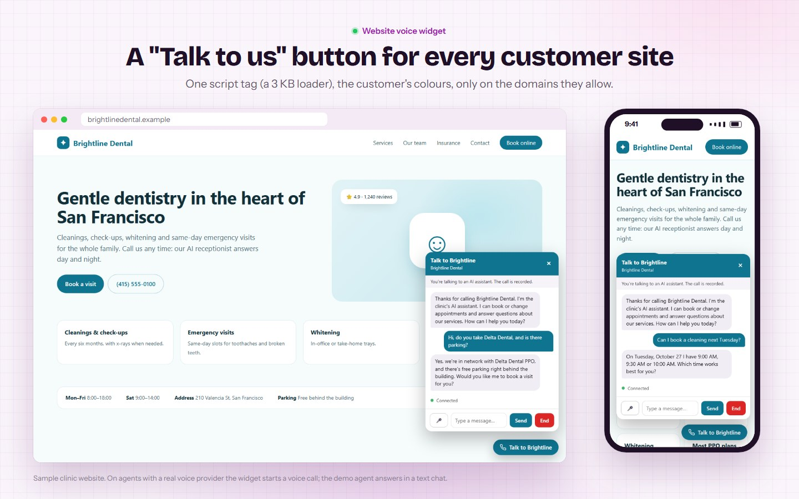
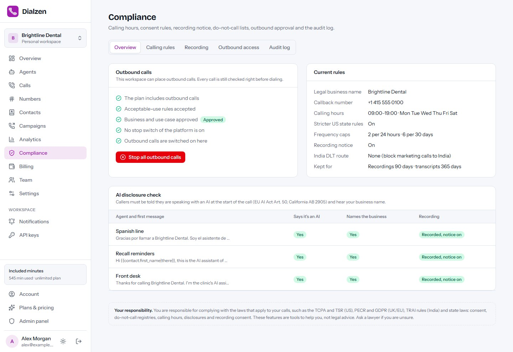
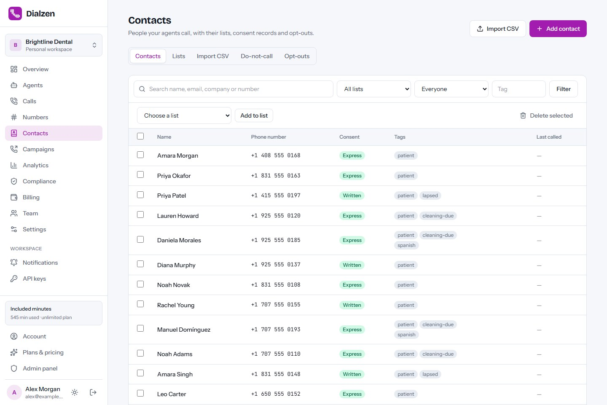
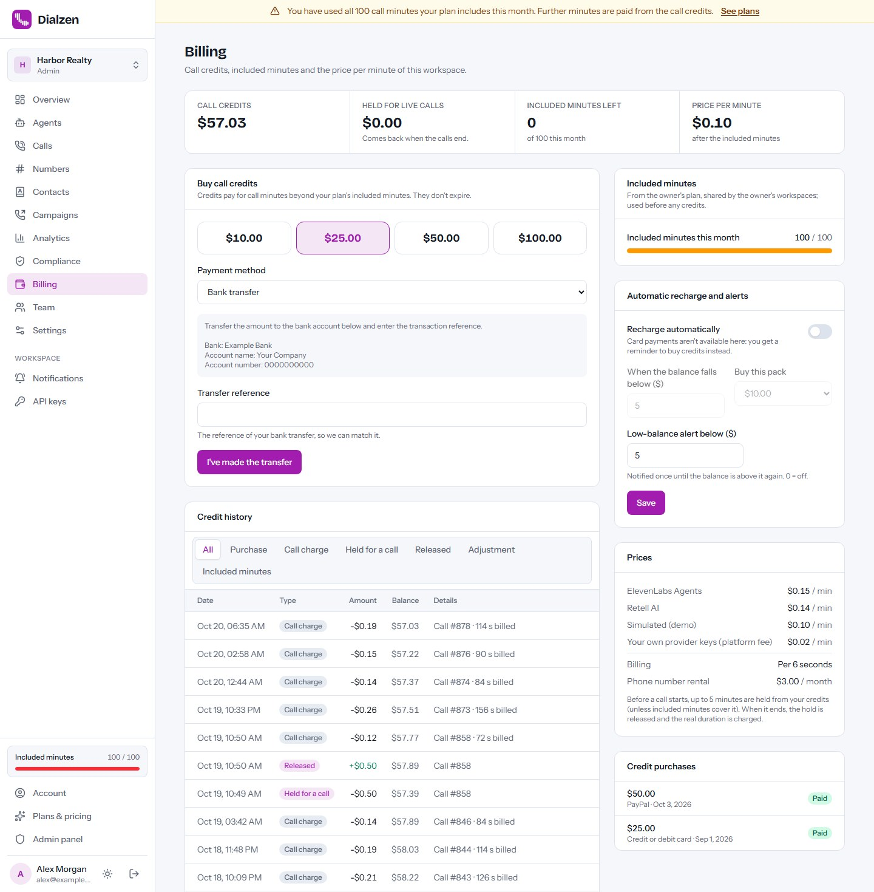
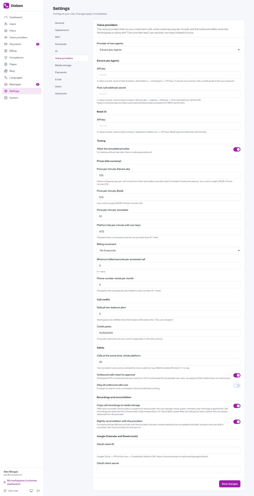

# Dialzen

**Open-source AI voice call agent platform — run your own AI phone agent SaaS.** Businesses create
AI phone agents for inbound support, appointment booking and consented follow-ups. Built with
Next.js 16, React 19 and Tailwind CSS 4. Runs on a VPS, Docker, cPanel (Node.js) or Vercel, with
MySQL/MariaDB/TiDB or a zero-setup SQLite database.

**Live demo:** https://dialzen-demo.vercel.app — log in with `demo@dialzen.app` / `demo12345`
(data resets regularly; the demo uses the Simulated voice provider and never places real calls).



Dialzen is the **control plane**: agents, knowledge base, tools, phone numbers, contacts, consent
records, do-not-call lists, campaigns, call credits and compliance live in your database. A managed
voice provider (**ElevenLabs Agents** or **Retell AI**, plus a **Simulated** provider for demos and
tests) runs the realtime audio, so no media server is needed.

## Features

- **Agent builder** with 8 templates, prompt variables, an AI prompt assistant, voices and
  languages, a knowledge base, behaviour settings and post-call analysis fields; browser test calls.
- **Tools:** Cal.com and Google Calendar booking, Google Sheets, signed webhooks, transfer to a
  person and end call.
- **Phone numbers:** buy US/Canada numbers (Retell), import Twilio and SIP trunk numbers, inbound
  routing and daily dial caps.
- **Call log** with recordings, transcripts, summaries, sentiment and extracted data, plus
  analytics with a heatmap.
- **Embeddable web widget** so website visitors can talk to an agent from the browser.
- **Contacts with consent records**, CSV import with dry run, lists, do-not-call lists and opt-out
  detection (English, Hindi, Arabic).
- **Campaigns for consented follow-ups** with dial-time compliance checks, calling windows in the
  contact's time zone, retries, pacing and live progress.
- **Compliance center:** AI disclosure, calling rules, recording notice and retention, outbound
  approval with KYC, kill switches and an append-only audit log with export.
- **Billing:** per-minute sell price, included minutes, prepaid credit wallet with
  reserve-then-settle, credit packs, auto-recharge and tenant P&L; Stripe, PayPal, Razorpay and
  bank transfer.
- **SaaS ready:** workspaces with roles and invites, plans with limits, workspace-own provider keys,
  notifications (email, Slack, Discord, Teams, Telegram, signed webhooks), a REST API, a blog and a
  full admin panel.
- **Multi-language** with right-to-left support (Arabic and Hindi packs included).
- **Web installer** for MySQL or SQLite, plus PM2 and Docker configurations.

> The compliance features are tools, not legal advice. Operators and their customers are
> responsible for the consent, telemarketing and recording rules that apply to their calls.

| Call detail | Website widget | Compliance center |
| --- | --- | --- |
|  |  |  |
| **Contacts with consent** | **Credit wallet** | **Admin → Voice providers** |
|  |  |  |

More screenshots are in [`marketing/final/screenshots`](marketing/final/screenshots).

## Hosted version & paid installation

Need Dialzen hosted for you, installed on your own server, or customised? Contact
**[EpiFive](https://www.epifive.com/services#custom-app-development)**.

- Step-by-step guide: [Dialzen on the EpiFive blog](https://www.epifive.com/blog/dialzen-open-source-ai-voice-agent)
- More open-source projects: [epifive.com/open-source](https://www.epifive.com/open-source)

## Quick start

```bash
git clone https://github.com/epifive/dialzen.git
cd dialzen/app
npm install
npm run dev
```

Open http://localhost:3000 — you are redirected to the web installer at `/install`. Choose
**SQLite** for a zero-setup local database, or **MySQL/MariaDB** for production.

Voice providers send webhooks to a public `https://` address, so on `localhost` use the
**Simulated** provider (Admin → Settings → Voice providers → Testing) or an HTTPS tunnel. Campaigns
run on time when the worker (`CRON_SECRET=… npm run worker`) or a cron job calls the scheduler
every minute.

Production, Docker, PM2, cPanel and Vercel setups, provider accounts and every setting are covered
in [`app/README.md`](app/README.md) and the full guide in
[`documentation/index.html`](documentation/index.html) (open it in a browser).

**Requirements:** Node.js 20.9+ (22.13+ for SQLite), MySQL 5.7+ / MariaDB 10.3+ / TiDB or SQLite,
HTTPS on a public domain (provider webhooks, microphone access), a 1-minute scheduler (cron URL or
worker), and an ElevenLabs or Retell AI account for real calls.

The ElevenLabs and Retell adapters follow the providers' documented APIs and are tested with
mocks; please [open an issue](https://github.com/epifive/dialzen/issues) if something doesn't work
with a live account.

## Repository layout

| Path | What |
| --- | --- |
| `app/` | The Next.js application (dashboard, agent builder, campaigns, admin, installer, worker) |
| `app/public/vendor/voice-sdk/` | Vendored provider browser SDKs (MIT / ISC / Apache-2.0, see `LICENSES.txt`) |
| `documentation/` | Full user and admin guide (single HTML file) |
| `marketing/final/` | Screenshots |

## Contributing

Bug reports and pull requests are welcome — please open an
[issue](https://github.com/epifive/dialzen/issues) first for larger changes. Run
`npm run lint`, `npm run typecheck` and `npm run build` in `app/` before sending a PR.

## License

[MIT](LICENSE) © 2026 EpiFive. The vendored browser SDKs in `app/public/vendor/voice-sdk` keep
their own licences (see [`LICENSES.txt`](app/public/vendor/voice-sdk/LICENSES.txt)).
